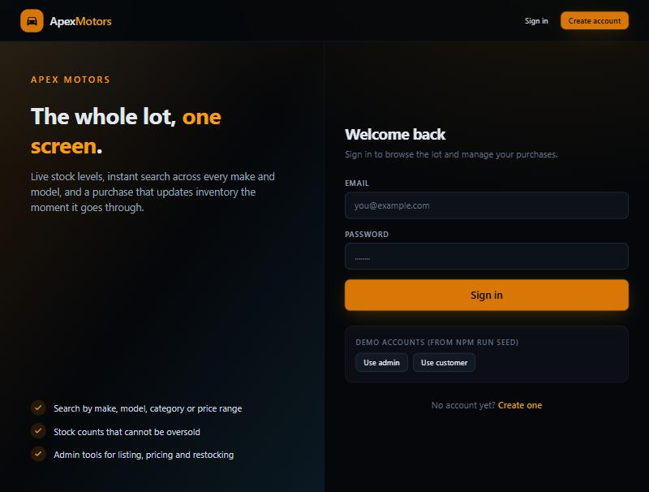
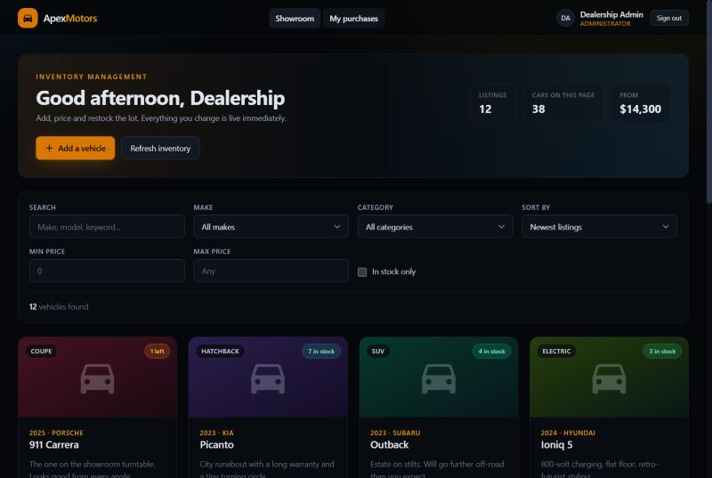
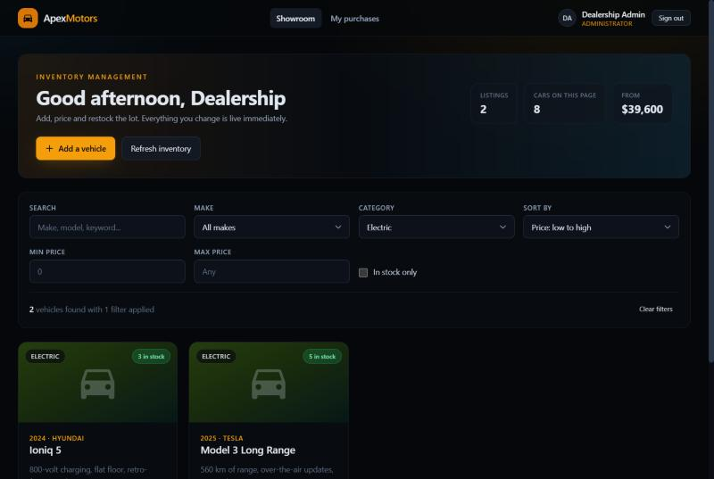
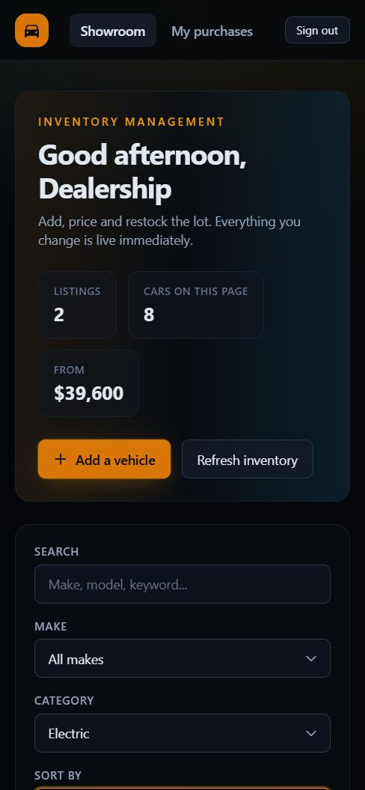

# Apex Motors — Car Dealership Inventory System

A full-stack dealership inventory application: a REST API with JWT authentication
and role-based permissions, backed by a real SQLite database, and a React single-page
app for browsing, searching, buying and managing the lot.

Built test-first. The backend was driven out by 137 tests written before the code they
describe, and the git history shows the Red → Green → Refactor loop one commit at a time.

| | |
| --- | --- |
| **Backend** | Node.js · TypeScript · Express · SQLite (better-sqlite3) · JWT · Zod |
| **Frontend** | React 18 · TypeScript · Tailwind CSS v4 · React Router · Vite |
| **Tests** | Vitest · Supertest · Testing Library — **173 tests, 94.8% backend coverage** |

---

## Table of contents

- [Screenshots](#screenshots)
- [Running it locally](#running-it-locally)
- [Demo accounts](#demo-accounts)
- [API reference](#api-reference)
- [Architecture](#architecture)
- [How TDD was actually applied](#how-tdd-was-actually-applied)
- [Testing](#testing)
- [Design decisions worth explaining](#design-decisions-worth-explaining)
- [My AI Usage](#my-ai-usage)
- [Project structure](#project-structure)

---

## Screenshots

### Sign in
Split-screen auth with one-click fills for the seeded demo accounts.



### The showroom (admin view)
Greeting, live inventory stats, admin actions, the filter bar and the vehicle grid.



### Vehicle grid, including a sold-out listing
Stock badges are colour-coded (`4 in stock` / `1 left` / `Sold out`). The sold-out
Subaru's purchase button is genuinely disabled and clearly greyed out, while its admin
controls stay available so it can be restocked.


### Search and filter
Category `Electric`, sorted by price. The bar reports the match count and offers
*Clear filters* once anything is applied.



### Admin: add a vehicle
One form serves add and edit. Server-side validation errors come back mapped to the
field that caused them.


### Admin: restock


### My purchases
Every purchase keeps the price that was actually paid, even if the listing is repriced
or removed later.


### Responsive
The whole app collapses to a single column on a phone.



---

## Running it locally

**Prerequisites:** Node.js 20 or newer (built and tested on 22.17) and npm.

The backend and the frontend are separate npm projects. Run them in two terminals.

### 1. Backend

```bash
cd backend
npm install
cp .env.example .env     # Windows PowerShell: copy .env.example .env
npm run seed             # creates the database, the demo accounts and 12 vehicles
npm run dev              # http://localhost:4000
```

Check it is up:

```bash
curl http://localhost:4000/api/health
```

### 2. Frontend

```bash
cd frontend
npm install
cp .env.example .env     # Windows PowerShell: copy .env.example .env
npm run dev              # http://localhost:5173
```

Open <http://localhost:5173> and sign in with one of the demo accounts below.

### Everything else

```bash
# Backend
npm test                 # 137 tests
npm run test:coverage    # with a v8 coverage report
npm run test:watch
npm run typecheck
npm run migrate          # apply migrations without seeding
npm run build && npm start   # compile to dist/ and run the compiled server

# Frontend
npm test                 # 36 tests
npm run build            # typecheck + production bundle
npm run preview          # serve the built bundle
```

### Configuration

`backend/.env` — every variable is validated at start-up, so a bad value fails
immediately instead of surfacing as a confusing runtime error.

| Variable | Default | Purpose |
| --- | --- | --- |
| `PORT` | `4000` | API port |
| `NODE_ENV` | `development` | `development` \| `test` \| `production` |
| `JWT_SECRET` | *(required)* | Signing secret, minimum 8 characters |
| `JWT_EXPIRES_IN` | `2h` | Access-token lifetime |
| `BCRYPT_ROUNDS` | `10` | Password hashing cost |
| `DATABASE_PATH` | `./data/dealership.db` | SQLite file, created on first run |
| `CORS_ORIGIN` | `http://localhost:5173` | Comma-separated allowed origins, or `*` |
| `SEED_ADMIN_EMAIL` | `admin@dealership.test` | Admin created by `npm run seed` |
| `SEED_ADMIN_PASSWORD` | `Admin123!` | Password for that admin |

`frontend/.env` — `VITE_API_URL`, default `http://localhost:4000/api`.

---

## Demo accounts

Created by `npm run seed`. They are local development credentials; change
`SEED_ADMIN_PASSWORD` before deploying anywhere real.

| Role | Email | Password | Can do |
| --- | --- | --- | --- |
| Admin | `admin@dealership.test` | `Admin123!` | Everything: add, edit, delete, restock |
| Customer | `customer@dealership.test` | `Customer123!` | Browse, search, buy, see own purchases |

Anyone can register at `/register`; new accounts are always customers. **Registration
can never create an admin** — the role is assigned by the service and a `role` field in
the request body is stripped before it is ever read. Admins exist only because the seed
script creates them.

---

## API reference

Base URL `http://localhost:4000/api`. Protected routes expect `Authorization: Bearer <token>`.

Every response uses one envelope:

```jsonc
// success
{ "success": true, "data": { /* ... */ }, "meta": { /* optional */ } }

// failure
{ "success": false, "error": { "code": "VALIDATION_ERROR", "message": "Validation failed",
  "details": [{ "field": "price", "message": "Price cannot be negative" }] } }
```

### Auth

| Method | Path | Access | Description |
| --- | --- | --- | --- |
| `POST` | `/auth/register` | public | Create a customer account, returns a token |
| `POST` | `/auth/login` | public | Exchange credentials for a token |
| `GET` | `/auth/me` | signed in | The current user — used to restore a session |

### Vehicles

| Method | Path | Access | Description |
| --- | --- | --- | --- |
| `GET` | `/vehicles` | signed in | List vehicles, paginated |
| `GET` | `/vehicles/search` | signed in | Filtered search (see below) |
| `GET` | `/vehicles/filters` | signed in | Distinct makes and categories, for dropdowns |
| `GET` | `/vehicles/:id` | signed in | A single vehicle |
| `POST` | `/vehicles` | **admin** | Add a vehicle |
| `PUT` | `/vehicles/:id` | **admin** | Update a vehicle (partial body) |
| `DELETE` | `/vehicles/:id` | **admin** | Delete a vehicle |

### Inventory

| Method | Path | Access | Description |
| --- | --- | --- | --- |
| `POST` | `/vehicles/:id/purchase` | signed in | Buy, decreasing stock. Body `{ "quantity": 1 }` |
| `POST` | `/vehicles/:id/restock` | **admin** | Add stock. Body `{ "quantity": 5 }` |
| `GET` | `/purchases/me` | signed in | The caller's own purchase history |

`GET /api/health` is public.

### Search parameters

`q`, `make`, `model`, `category`, `minPrice`, `maxPrice`, `minYear`, `maxYear`,
`availableOnly`, `sort` (`newest` · `oldest` · `price_asc` · `price_desc` · `year_desc` ·
`year_asc`), `page`, `limit` (max 100).

```bash
curl "http://localhost:4000/api/vehicles/search?make=toyota&minPrice=20000&maxPrice=40000&availableOnly=true&sort=price_asc" \
  -H "Authorization: Bearer $TOKEN"
```

`make` and `model` match partially and case-insensitively; `category` matches exactly but
case-insensitively; `q` searches across make, model, category and description. Filters
combine with AND, and the `meta` block carries `total`, `page`, `limit` and `totalPages`.

### Status codes

`200` OK · `201` created (including a purchase, which creates a ledger entry) ·
`204` deleted · `400` malformed JSON · `401` missing/invalid token · `403` wrong role ·
`404` unknown resource · `409` duplicate listing or insufficient stock ·
`422` validation failed, with per-field details.

---

## Architecture

```
HTTP  ─▶  routes          declare the permission model (authenticate, requireAdmin)
          controllers     parse and validate input, call a service, shape the response
          services        the business rules — no Express, no SQL
          repositories    all SQL, mapping rows to domain objects
          SQLite          constraints as the last line of defence
```

Each layer only knows about the one below it, through an interface rather than a concrete
dependency:

- **`createApp(db)` takes a database handle** instead of opening one. That single decision
  is what lets the integration tests run the *real* application against a throwaway
  database file, with no mocking of Express and no shared state between test files.
- **`buildContainer(db)` is the only place wiring happens.** Every class receives its
  collaborators through its constructor, so nothing reaches for a module-level singleton.
- **Services depend on repositories, not on `better-sqlite3`.** Swapping SQLite for
  Postgres means rewriting the repository files and nothing else.
- **Errors are thrown, not rendered.** Services throw `NotFoundError`, `ConflictError`,
  `ForbiddenError`; one error middleware is the only place that turns an error into a
  status code. Adding a second transport (a CLI, a queue worker) would not mean
  re-implementing the rules.
- **Validation lives at the edge.** Zod schemas parse untrusted input in the controller,
  so every layer below can assume its inputs are well-formed.

---

## How TDD was actually applied

The commit history is the evidence. Tests were committed *first*, in a failing state,
then the implementation that makes them pass:

```
test: specify the database schema before writing it (RED)
feat: add migrating SQLite database layer (GREEN)
test: specify auth primitives and AuthService behaviour (RED)
feat: implement auth primitives, user repository and AuthService (GREEN)
test: specify the auth HTTP contract end to end (RED)
feat: expose auth over HTTP with JWT middleware (GREEN)
test: specify the vehicle catalogue and search rules (RED)
feat: add vehicle catalogue with filtered, paginated search (GREEN)
refactor: enforce the vehicle natural key in the database too (REFACTOR)
test: specify stock movement rules before implementing them (RED)
feat: add atomic purchase and restock with a purchase ledger (GREEN)
test: specify the vehicle and inventory HTTP contract (RED)
feat: expose vehicle CRUD, search and inventory endpoints (GREEN)
```

Each `RED` commit was verified failing before the matching `GREEN` commit was written.
The cycle paid for itself in three places in particular:

1. **The SQL wildcard test.** Writing `expect(service.search({ make: '%' }).total).toBe(0)`
   *before* the query builder existed is what forced LIKE patterns to escape `%`, `_` and
   `\` with an `ESCAPE` clause. Written afterwards, that test would probably never have
   been thought of.
2. **The oversell test.** `never lets stock go negative, however many buyers compete for
   it` ruled out the obvious read-then-write implementation before it was typed, and
   produced the guard-in-the-`WHERE`-clause design instead.
3. **The privilege-escalation test.** Asserting that `register({ role: 'ADMIN' })` still
   returns a customer pinned down a security property as executable documentation.

The `REFACTOR` commit is a genuine one: the make/model/year uniqueness rule already
worked in the service, and was pushed down into a unique database index so no future code
path can bypass it. Same behaviour, stronger guarantee, tests still green.

---

## Testing

```bash
cd backend  && npm run test:coverage   # 137 tests
cd frontend && npm test                # 36 tests
```

**173 tests, all passing.** Full output, per-file coverage and a breakdown of what each
suite covers: **[docs/TEST-REPORT.md](docs/TEST-REPORT.md)**.

| Metric | Backend coverage |
| --- | --- |
| Statements | 94.76% |
| Branches | 84.68% |
| Functions | 96.77% |
| Lines | 94.76% |

Unit tests cover services and utilities in isolation. Integration tests drive the real
Express app through Supertest against a real, file-backed SQLite database — each test
file gets its own database in a temp directory, so suites never interfere with each other
or with development data. The frontend tests cover the API client's envelope and error
handling, and the component behaviour the brief calls out by name — most of all that the
purchase button is disabled at zero stock.

---

## Design decisions worth explaining

**A purchase ledger, not just a counter.** `POST /purchase` writes a row recording who
bought what, how many, and the unit price *at the time*. Decrementing a number would have
satisfied the brief, but it loses the receipt; snapshotting the price means repricing or
deleting a listing never rewrites a buyer's history (the history query `LEFT JOIN`s, so a
deleted listing still shows up as a past purchase).

**Overselling is impossible, not merely unlikely.** The stock guard is part of the
`UPDATE`:

```sql
UPDATE vehicles SET quantity = quantity - ? WHERE id = ? AND quantity >= ?
```

paired with a transaction around the decrement and the ledger insert, and a
`CHECK (quantity >= 0)` constraint underneath. If two buyers race for the last car,
exactly one `UPDATE` reports a changed row; the other gets a `409`.

**Writes are admin-only across the board.** The brief marks only `DELETE` and `restock`
as admin-only, but it also asks for admin-only add/update UI, so `POST` and `PUT` are
restricted too. Customers browse and buy.

**Login failures are deliberately indistinguishable.** A wrong password and an unknown
email return the same `401` and the same message, so the endpoint cannot be used to
enumerate registered emails.

**A vehicle's natural key is make + model + year.** Listing the same model-year twice is a
restock, not a second listing, so it returns `409` — enforced in the service *and* by a
unique index on `(lower(make), lower(model), year)`.

**One response envelope everywhere**, so the frontend needs exactly one response handler
and one error translation.

**Known limitations**, stated plainly: tokens are stored in `localStorage` (simple and
appropriate here, though an httpOnly cookie resists XSS better); there is no refresh-token
flow, so a session ends after `JWT_EXPIRES_IN`; there is no rate limiting on the auth
endpoints; vehicle images are category-tinted placeholders rather than uploads; and SQLite
is a single-writer database, which suits a dealership but would not suit a high-write
service.

---

## My AI Usage

I used **Claude (via Claude Code, the CLI/desktop agent)** throughout this project. Every
commit that involved AI assistance carries a `Co-authored-by: Claude` trailer, and the
raw, unedited session log is in **[PROMPTS.md](PROMPTS.md)**.

### What I used it for

**Boilerplate and scaffolding — the bulk of it.** Package manifests, `tsconfig`, the
Vitest configuration, the Express router and controller wiring, repository row-mapping
functions, React component shells, Tailwind class strings and the inline SVG icons. This
is mechanical code where an AI is simply faster than typing, and where mistakes are caught
immediately by the type checker and the tests.

**Expanding test cases from a checklist.** This was the highest-value use. I would decide
*what* needed proving — "search must not let a user type `%` and get the whole inventory",
"two buyers racing for the last car must not both succeed" — and ask for the cases to be
written out, including the table-driven validation tests. The judgement about which
properties matter stayed mine; the typing did not.

**Rubber-ducking design decisions.** Where to put the stock guard (service check versus
`WHERE` clause), whether purchases deserved their own table, how to keep authorisation out
of the controllers. I asked for the trade-offs and then chose.

**Debugging.** Two real bugs, both found by tools rather than by reading:

- `parseOrThrow` was generic over the payload type rather than the schema, so schemas that
  *transform* their input (lower-case `"sedan"` → the `SEDAN` enum member, `"true"` → a
  boolean) handed callers the raw request type. `tsc` caught it; the fix was to make the
  function generic over the schema and return `z.output<S>`.
- A disabled primary button rendered as near-black text on no background at all — because
  my own `disabled:hover:bg-inherit` utility wiped the background whenever a disabled
  button was hovered. I found this by driving the running app in a browser, inspecting the
  computed style of the sold-out card's button, and seeing `rgba(0, 0, 0, 0)`. The fix was
  to scope hover styles with `enabled:` and give the disabled state one explicit,
  legible appearance. That state is exactly the one the brief cares about, so it was worth
  getting right rather than merely "technically disabled".

### What I did *not* delegate

The architecture (the layering, dependency injection through `createApp(db)` and
`buildContainer`, the error taxonomy), the database schema and its constraints, the
permission model, and — most importantly — **the decision about what to test**. An AI will
cheerfully write a hundred tests that assert the implementation back at you. Deciding that
*atomicity*, *price snapshotting* and *email enumeration* were the properties worth pinning
down is the part that actually made the suite useful, and that judgement is not something
I outsourced.

### Reflection

The honest summary is that AI changed the *distribution* of my time rather than simply
reducing it. Far less time went on boilerplate and syntax; considerably more went on
deciding what the system should guarantee, reviewing generated code, and chasing the two
bugs above. That trade is worth making, but only with guardrails: `strict` TypeScript, a
test suite written before the implementation, and running the real application in a
browser rather than trusting that generated UI code works.

The two bugs are instructive. Neither was caught by reading the code — both looked
perfectly reasonable, and the button one was *generated confidently* with an inline
comment explaining its intent. They were caught by a type checker and by inspecting a live
DOM. That is the lesson I would carry forward: AI accelerates producing plausible code, so
the verification layer has to get *stronger*, not weaker. TDD is a good fit precisely
because the test is written while you are still thinking about the problem rather than
about the solution.

---

## Project structure

```
.
├── backend/
│   ├── src/
│   │   ├── config/env.ts            Zod-validated environment, parsed once
│   │   ├── db/                      migrations, connection, transactions, seed
│   │   ├── repositories/            all SQL (user, vehicle, purchase)
│   │   ├── services/                business rules (auth, vehicle, inventory)
│   │   ├── controllers/             HTTP adapters
│   │   ├── routes/                  routers + the permission model
│   │   ├── middleware/              authenticate, requireRole, error handler
│   │   ├── validation/              Zod request schemas
│   │   ├── utils/                   errors, password, token, response envelope
│   │   ├── container.ts             composition root
│   │   ├── app.ts                   createApp(db)
│   │   └── server.ts                process entry point
│   └── tests/
│       ├── unit/                    schema, password, token, the three services
│       ├── integration/             auth and vehicle endpoints via Supertest
│       └── helpers/                 throwaway database + test app factories
├── frontend/
│   ├── src/
│   │   ├── lib/                     API client, formatters
│   │   ├── context/                 AuthContext, ToastContext
│   │   ├── hooks/useVehicles.ts     search with request cancellation
│   │   ├── components/              ui primitives, vehicle components, layout
│   │   ├── pages/                   login, register, showroom, purchases
│   │   └── index.css                design tokens (Tailwind v4 @theme)
│   └── tests/                       API client, VehicleCard, filters, formatters
├── docs/
│   ├── TEST-REPORT.md               full suite output and coverage
│   └── screenshots/
├── PROMPTS.md                       raw, unedited AI session log
└── README.md
```

---

Built as a TDD kata. The interesting parts are the test suite and the commit history —
`git log --oneline` tells the story better than this README does.
